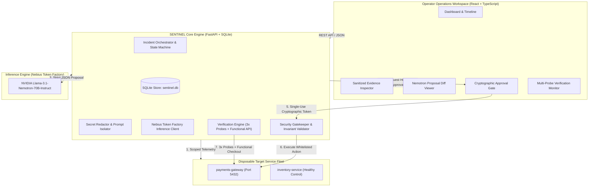

# SENTINEL 🛡️

**NVIDIA Nemotron-Powered Workspace for Autonomous Incident Diagnosis & Approval-Gated Recovery**

[](https://nebiusglobalaihackathon.devpost.com)
[](https://tokenfactory.nebius.com)
[](https://tokenfactory.nebius.com)
[](backend/tests)

---

## 📋 Overview

**SENTINEL** is an autonomous incident diagnosis and recovery operations workspace designed for high-reliability cloud architectures.

In production environments, autonomous agents cannot be granted unchecked write access. Hallucinated remediation scripts, prompt injections hidden in application logs, and race conditions from configuration drift can easily turn minor service degradations into catastrophic outages.

SENTINEL pairs **NVIDIA Llama-3.1-Nemotron-70B-Instruct** (hosted on **Nebius Token Factory**) with an approval-gated security perimeter:
- **Autonomous Telemetry Scoping:** Collects live health checks, configuration diffs, and recent application logs upon incident creation.
- **Secret Redaction & Prompt Isolation:** Strips bearer tokens, JWTs, and API keys before inference, isolating untrusted log telemetry inside protective anti-injection boundaries.
- **Grounded Nemotron Diagnosis:** Synthesizes root causes, estimates epistemic uncertainty, cites explicit evidence IDs (`EV-*-01`), and formulates strictly typed remediation proposals (`restore_demo_config`).
- **Cryptographic Approval Gate:** Generates ephemeral (5-minute TTL), single-use approval tokens cryptographically bound to the service state hash. Any background configuration drift invalidates the approval immediately.
- **Empirical Multi-Probe Verification:** A successful remediation command alone **never** marks an incident as resolved. Recovery is strictly gated behind **3 consecutive healthy probes** over the verification window and **1 functional checkout transaction**.
- **Audit-Ready Post-Mortems:** One-click generation and export of structured Markdown and JSON incident reports.

---

## 🏛️ System Architecture



### Incident State Machine
SENTINEL strictly enforces seven distinct operational states:
```
Investigating ➔ Awaiting approval ➔ Executing ➔ Verifying ➔ Recovered / Unresolved / Cancelled
```
* **Investigating:** Telemetry gathered; evidence scoped and sanitized.
* **Awaiting approval:** Nemotron proposal formulated; locked behind 5-minute single-use approval token.
* **Executing:** Operator approved; whitelisted action dispatched to target service.
* **Verifying:** Multi-probe verification loop actively running (3 consecutive health checks + 1 functional API checkout transaction).
* **Recovered:** Verified healthy across all 3 probes and functional transaction.
* **Unresolved:** Remediation write failed, health probe degraded, or functional check failed.
* **Cancelled:** Operator aborted investigation.

---

## ⚙️ Detailed Setup & How to Run

### System Requirements
* **Python 3.10+** (tested on Python 3.14)
* **Node.js 18+** & **npm 9+**
* Supported OS: Windows, Linux, macOS

---

### Step 1: Install Dependencies

#### Python Backend Dependencies:
```bash
pip install fastapi uvicorn httpx pydantic pydantic-settings pytest pytest-asyncio
```

#### Frontend Dependencies:
```bash
cd frontend
npm install
npm run build
cd ..
```
*(The production frontend build is automatically compiled into `frontend/dist` and served directly by the FastAPI backend).*

---

### Step 2: Configure Environment Variables

Create a `.env` file in the project root:

```bash
# On Linux/macOS:
cp .env.example .env

# On Windows PowerShell:
Copy-Item .env.example .env
```

Open `.env` and verify the settings:

```env
# Nebius Token Factory API Key (https://tokenfactory.nebius.com)
NEBIUS_API_KEY=your_nebius_api_key_here

# Nebius Token Factory Endpoint & NVIDIA Nemotron Model ID
NEBIUS_BASE_URL=https://api.tokenfactory.nebius.com/v1
NEMOTRON_MODEL_ID=nvidia/Llama-3.1-Nemotron-70B-Instruct

# Runtime Configuration
SENTINEL_DB_PATH=sentinel.db
SENTINEL_PORT=8000
APPROVAL_EXPIRY_SECONDS=300
VERIFICATION_PROBE_INTERVAL_SECONDS=10.0
```

> **Transparent Offline Fixture Mode:** If `NEBIUS_API_KEY` is not set, SENTINEL operates seamlessly in deterministic offline fixture mode. The interface displays an orange badge indicating offline fixture mode and notes the missing credential check, allowing full evaluation of all features without requiring active API keys.

---

### Step 3: Start the Application

Run the unified SENTINEL server:

```bash
python -m uvicorn backend.main:app --host 0.0.0.0 --port 8000
```

Open your browser and navigate to:
```
http://localhost:8000
```

*(Optional: For frontend hot-reloading development, run `npm run dev` in `frontend/` on port 5173).*

---

## 🧪 Reproducible Fault-Injection Demo

SENTINEL includes a built-in disposable service fleet with a known configuration fault and a healthy service control:
* **`payments-gateway`**: Critical payment processing service handling transactions against an upstream Postgres cluster (`pg-cluster.internal:5432`).
* **`inventory-service`**: Healthy control service providing baseline operational metrics.

### Step-by-Step Incident Walkthrough

1. **Inject Configuration Fault:**
   Click **"Inject Fault"** in the top navbar (or send `POST /api/services/fault` with `{"service": "payments-gateway", "fault_type": "DB_PORT_MISCONFIG"}`).
   - An automated deployment pipeline errantly shifts `DB_PORT` from `5432` to `5433`.
   - `payments-gateway` immediately degrades to **HTTP 503 (DatabaseConnectionTimeout)**.
   - The healthy control (`inventory-service`) remains completely green at 200 OK.

2. **Autonomous Evidence Collection:**
   An incident (`inc_...`) opens automatically, collecting 3 scoped telemetry artifacts:
   - `EV-*-01`: Health probe failure telemetry (`get_health`).
   - `EV-*-02`: Configuration diff highlighting `DB_PORT: 5432 -> 5433` (`get_config_diff`).
   - `EV-*-03`: Application logs with bearer tokens automatically redacted (`get_logs`).

3. **NVIDIA Nemotron Diagnosis:**
   Click **"Run Nemotron Diagnosis"**.
   - NVIDIA Nemotron synthesizes evidence via Nebius Token Factory.
   - Cites exact evidence IDs (`[EV-*-01, EV-*-02]`) and computes an epistemic uncertainty of `4% (Low)`.
   - Outputs a typed, whitelisted proposal: `restore_demo_config(service='payments-gateway', expected_hash=...)`.
   - Formulates a concrete rollback procedure.
   - Displays a sanitized trace card (endpoint host, model ID, latency, token usage, request ID).

4. **Cryptographic Approval Gate:**
   - The backend locks the proposal into an ephemeral single-use token with a 5-minute validity window.
   - The token is cryptographically bound to the service state hash. If background configuration drift occurs, the token invalidates automatically.
   - The human operator reviews the diff and clicks **"Approve Remediation"**.

5. **Execution & Multi-Probe Verification:**
   Click **"Execute Recovery & Run Verification Probes"**.
   - The approval token is consumed atomically to prevent replay attacks.
   - The configuration is restored to golden baseline.
   - **Verification Loop Executes:**
     - **Probe #1 (0s):** Health check 200 OK (11ms latency).
     - **Probe #2 (10s):** Health check 200 OK (12ms latency).
     - **Probe #3 (20s):** Health check 200 OK (11ms latency).
     - **Functional Checkout Test:** `POST /api/v1/charge ($49.99)` succeeds with an authorized transaction ID.
   - SENTINEL awards the final verdict: **`Recovered`**.

6. **Export Incident Report:**
   Click **"Export Incident Report"** to view and download the post-incident audit trail in Markdown or JSON format.

7. **Reset Services:**
   Click **"Reset Demo"** at any time to restore all services and logs to the golden state.

---

## 🔒 Security Invariants & Policy Enforcement

SENTINEL implements strict safety controls in backend code:
1. **Narrow Whitelist:** Only `get_health`, `get_logs`, `get_config_diff`, and `restore_demo_config` are permitted. Arbitrary shell commands, host filesystem access, Docker socket calls, and production credential exports are strictly blocked.
2. **Single-Use Approvals:** Approvals cannot be replayed. Once executed, the token is consumed.
3. **5-Minute Expiry:** All approval bindings expire after 300 seconds. Expired approvals produce zero writes.
4. **State Drift Invalidation:** If the target service's configuration changes between approval and execution, the approval is invalidated (`CONFIG_DRIFT_INVALIDATED`).
5. **Anti-Prompt-Injection Delimiters:** Untrusted telemetry is isolated inside `<untrusted_evidence>` tags instructing the model that logs are strictly passive evidence, never actionable instructions.

---

## 🔬 Automated Test Suite

SENTINEL includes an automated test suite verifying all required security and operational properties:

```bash
python -m pytest backend/tests/test_sentinel.py -v
```

### Verified Test Cases:
| Test Suite | Focus Area | Status | Verified Outcome |
| :--- | :--- | :---: | :--- |
| `test_known_fault_and_healthy_control` | Fault isolation | ✅ **PASS** | `payments-gateway` produces HTTP 503; `inventory-service` control remains healthy at 200 OK. |
| `test_rejected_expired_and_replayed_approvals` | Gatekeeper defense | ✅ **PASS** | Rejected, expired (>5m), and replayed tokens produce 0 writes (`APPROVAL_REJECTED`, `EXPIRED_APPROVAL`, `REPLAYED_APPROVAL`). |
| `test_changed_arguments_and_config_hashes_invalidate` | Anti-tampering | ✅ **PASS** | Modifying arguments produces `ARGUMENTS_TAMPERED`; background config drift produces `CONFIG_DRIFT_INVALIDATED`. |
| `test_malicious_prompt_injection_in_logs` | Security & injection defense | ✅ **PASS** | Raw JWTs/passwords in logs are redacted; untrusted injection text is neutralized; unauthorized tools (`execute_shell`) fail whitelist check (`DISALLOWED_TOOL`). |
| `test_invalid_model_output_fails_closed` | Schema validation | ✅ **PASS** | Malformed model responses and empty evidence citations fail closed safely. |
| `test_failed_post_recovery_checks_produce_unresolved` | Verification invariant | ✅ **PASS** | Unhealthy probes or failed functional API calls produce `Unresolved`, never `Recovered`. |
| `test_end_to_end_recovery_lifecycle` | Complete workflow | ✅ **PASS** | Fault injection ➔ Scoped evidence ➔ Nemotron diagnosis ➔ Operator approval ➔ Execution ➔ 3x probes ➔ Functional check ➔ Markdown report export. |
| `test_five_resettable_fault_trials` | Reliability & repeatability | ✅ **PASS** | Executed 5 consecutive fault and recovery cycles across port misconfigurations and timeouts with 100% verified recoveries. |

